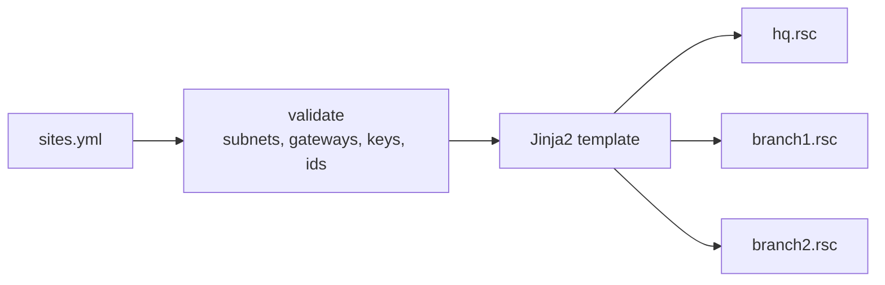

# mikrotik-site-to-site

[](https://github.com/Walaskien/mikrotik-site-to-site/actions/workflows/ci.yml)

Generate RouterOS 7 configuration for site-to-site links between two or more MikroTik routers, from one YAML file.

Writing the same WireGuard peers, routes and firewall rules by hand on every router is slow, and the sites drift apart (one has the NAT rule in the wrong place, another forgot the MSS clamp). Here you describe the sites once and get one ready-to-review `.rsc` file per router.

For each site the generator produces:

- WireGuard tunnels to every other site (full mesh), with peer keys from the input; private keys are created on the routers and never stored in files;
- an optional second tunnel over a second WAN link, with route `distance` and `check-gateway=ping` for failover;
- routes to remote LANs, plus `/32` routes that pin each tunnel endpoint to its own WAN;
- a firewall baseline (default deny on input and forward, tunnels only from known peers, management only from named networks), NAT, and a TCP MSS clamp for tunnels.

The reasoning behind the rule order, the failover and the usual mistakes is in [docs/design.md](docs/design.md).

## How it works



## Quick start

Python 3.9+.

```console
python3 -m venv .venv && . .venv/bin/activate
pip install -r requirements.txt
cp examples/three-sites.yml mysites.yml     # edit addresses, interfaces, public keys
python -m s2s validate mysites.yml          # checks the input, writes nothing
python -m s2s generate mysites.yml -o out   # out/<site>.rsc
```

Then, per router: take a `/system backup`, upload the file, run `/import file-name=<site>.rsc`. The file assumes the router has no conflicting WAN/LAN addresses, firewall or WireGuard configuration; it is meant for a new or cleaned router, not for merging into a running production config.

Public keys: the first import creates the WireGuard interfaces and their keys. Read them with `/interface/wireguard print`, put them in the YAML (`public_key`, `backup_public_key`), regenerate, and re-import on a clean router (or add the peers by hand).

`validate` rejects: overlapping LAN subnets, a gateway outside its WAN subnet, duplicate site names or ids, malformed addresses and public keys, a backup link without a backup key, equal tunnel ports, fewer than two sites. All problems are listed at once.

## Verified

Python 3.9.6, macOS:

| Check | Result |
|---|---|
| `pytest -q` | 15 passed: input validation (each rejection above), deterministic output, golden `.rsc` files for the example, no `private-key` in output, per-site backup logic, CLI exit codes |
| `ruff check .` | all checks passed |
| `python -m s2s validate examples/three-sites.yml` | OK: 3 sites |
| GitHub Actions (`ci`, run 42587344103, commit "Translate docs to English") | success: `ruff`, `pytest` and `validate` on Python 3.9 and 3.12 |

**Not verified:** the generated configuration was not applied to RouterOS hardware or to a CHR virtual machine. The syntax was written against the RouterOS 7 documentation and not machine-checked. Treat the output as a reviewed starting point and test on spare equipment first. The failover timing in the design document is the expected behaviour of `check-gateway`, not a measurement.

## Limits

- WireGuard only. IPsec is not generated.
- Full mesh, every site needs a fixed public IP. No sites behind NAT or with dynamic addresses.
- One LAN per site, IPv4 only, no dynamic routing (OSPF/BGP), no DNS/DHCP/VLAN configuration.
- Golden files must be updated deliberately when the template changes: `UPDATE_GOLDEN=1 pytest`.

## Repository layout

```
s2s/             config.py (validation), render.py, cli.py, templates/router.rsc.j2
examples/        three-sites.yml  (documentation addresses, dummy keys)
tests/           pytest + golden/*.rsc
docs/design.md   topology, failover, firewall order, common mistakes
```

## Related

- [dual-homed-routing](https://github.com/Walaskien/dual-homed-routing): the same asymmetric-routing problem on a Linux host.
- [ansible-linux-baseline](https://github.com/Walaskien/ansible-linux-baseline): baseline for the Linux servers behind these routers.
