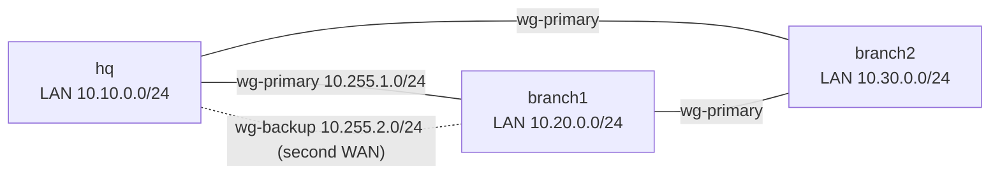

# Design

## Topology



Every site peers with every other site (full mesh). A site with a second WAN link also gets `wg-backup`, built on that link, towards every other site that has one too. Sites without a second link have only `wg-primary`.

Each site gets `10.255.1.<id>` on `wg-primary` and `10.255.2.<id>` on `wg-backup`. `id` comes from the input.

IPsec is not generated. WireGuard was chosen because the configuration is short and the same on every site.

## How failover works

Two mechanisms, both plain RouterOS routing:

1. **Internet access.** Two default routes: primary gateway `distance=1`, backup gateway `distance=2`, both with `check-gateway=ping`. When the primary gateway stops answering, its route becomes inactive and the backup route takes over.
2. **Site-to-site.** Each remote LAN has two routes: via the far end of `wg-primary` (`distance=1`) and via the far end of `wg-backup` (`distance=5`), both with `check-gateway=ping`, so the "gateway" is the remote tunnel address. If the remote end stops answering through the primary tunnel, traffic moves to the backup tunnel.

Every tunnel endpoint has a `/32` route pinned to its own WAN gateway. Without it, when the primary WAN is down the primary tunnel's packets would leave through the backup link (the default route), and the primary tunnel would not be a clean signal of the primary path.

`check-gateway=ping` only checks the next hop. For an Internet failure behind a healthy first hop, the tunnel check (which crosses the Internet) is the useful one; the Internet default routes only protect against a dead first hop.

## Firewall order

Rules run top to bottom, first match wins. The generated order and why:

| Chain | Order | Reason |
|---|---|---|
| input | established/related/untracked, then drop invalid | cheap, handles most packets first |
| input | ICMP, own LAN | basic diagnostics and management from inside |
| input | UDP WireGuard ports from known peer addresses on WAN | tunnels come up only for peers in the input; others are dropped by the last rule |
| input | SSH/Winbox from `management_sources` | management from named networks only |
| input | drop everything not from LAN | default deny |
| forward | established, drop invalid | as above |
| forward | LAN to remote LANs, remote LANs to LAN | the actual site-to-site traffic; source is checked against the remote-LAN list |
| forward | **drop** LAN to WAN with a remote-LAN destination | if a tunnel is down, remote-LAN traffic must not leak to the Internet |
| forward | LAN to WAN | normal Internet access |
| forward | dstnat, then drop | port forwards allowed; everything else denied |

NAT has one rule: `masquerade` on `out-interface-list=WAN`. Tunnel traffic leaves through `wg-*`, not through a WAN interface, so it is never masqueraded. Adding a masquerade for tunnels is the usual cause of "ping works one way, TCP breaks" and of remote servers logging the router's address instead of the client's.

## How to check the tunnel and the failover

After applying the files and copying each router's public keys (`/interface/wireguard print`) into the input, regenerate and re-apply.

```
/interface wireguard peers print                 # last-handshake should be recent (< 2 min)
/ping 10.255.1.1 interval=1 count=5              # far end of the tunnel
/ping 10.10.0.1 src-address=10.20.0.1 count=5    # LAN to LAN, from the router
/ip route print where dst-address=10.10.0.0/24   # active route has the "A" flag
```

Failover test: disable the primary WAN interface (`/interface disable ether1`) and watch `/ip route print where dst-address=10.10.0.0/24`. The backup route should become active within a few `check-gateway` intervals (about 10 s). Enable the interface again and the primary route returns.

## Common mistakes

- **MTU / MSS.** WireGuard adds about 60-80 bytes. Tunnel MTU 1420 fits an Ethernet WAN of 1500. Over PPPoE (1492) or other smaller paths lower `tunnel.mtu`. Symptom of a wrong value: ping works, small web pages work, large downloads or HTTPS to some hosts hang. The generated mangle rule clamps TCP MSS on tunnel egress; UDP and ICMP are not clamped.
- **NAT order / masquerade.** See above: do not masquerade tunnel traffic. A srcnat rule with no `out-interface-list` matches everything, including the tunnel.
- **Asymmetric routing.** If a site has two links and the reply to a request leaves through a different link than the request came in on, stateful firewalls drop it. The endpoint `/32` routes and `distance` values keep each tunnel on its own link. The same family of problem on a Linux host with two NICs is explained in the [dual-homed-routing](https://github.com/Walaskien/dual-homed-routing) repository.
- **Overlapping subnets.** Two sites using the same LAN range cannot route to each other. The generator refuses overlapping LANs.
- **allowed-address too wide.** `0.0.0.0/0` as `allowed-address` on a peer makes it a catch-all and steals the default route. The generator allows only the peer's tunnel address and LAN.
- **Peer behind NAT or with a dynamic address.** Not supported: the generator needs a fixed public address for each site's `wan.address`.
